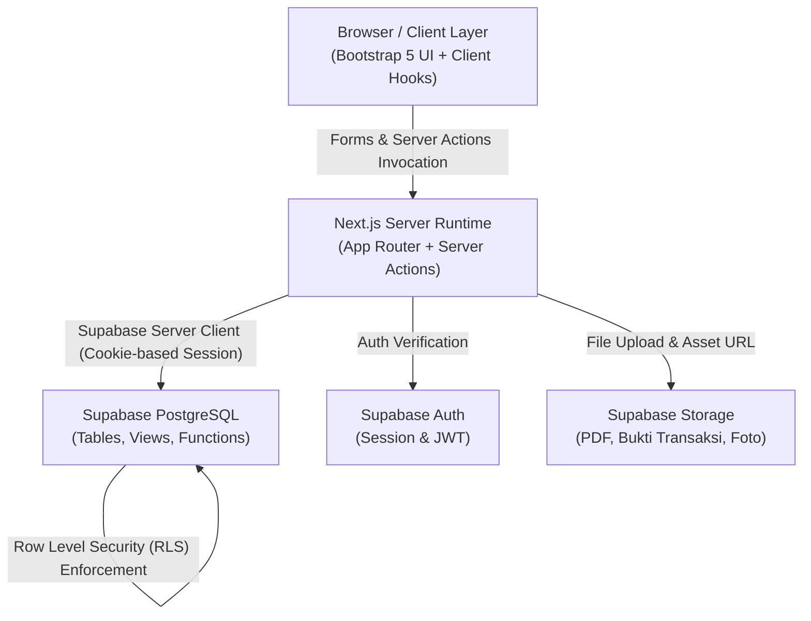

# Arsitektur Sistem – SIM GKJ Mijen

Dokumen ini menjelaskan fondasi arsitektur perangkat lunak untuk aplikasi **Sistem Informasi Manajemen Gereja Kristen Jawa Mijen (SIM GKJ Mijen)**.

---

## 1. Filosofi & Pola Arsitektur

Sistem dirancang menggunakan pendekatan **Modular Monolith berbasis Domain/Feature (Feature-Driven Architecture)** di atas framework **Next.js (App Router)** dan platform **Supabase (PostgreSQL, Auth, Storage)**.

### Prinsip Utama:
1. **Separation of Concerns (SoC)**: Logika presentasi visual (Frontend) terpisah secara tegas dari logika bisnis, orkestrasi mutasi data, dan keamanan (Backend/Server Actions).
2. **Feature-First Organization (`src/features/`)**: Setiap domain fungsional gereja (Jemaat, Surat, Keuangan, dll.) mengelompokkan `types`, `validations`, `services`, `actions`, `components`, dan `hooks` secara mandiri.
3. **Type Safety End-to-End**: Mulai dari definisi skema PostgreSQL hingga ke komponen formulir UI menggunakan TypeScript interface dan validasi skema runtime (Zod).
4. **Zero Client Secret Exposure**: Kredensial sensitif seperti `SUPABASE_SERVICE_ROLE_KEY` hanya diakses pada layer runtime server (Server Actions / Server Components).

---

## 2. Struktur Layering Aplikasi

| Layer | Lokasi Direktori | Tanggung Jawab Utama |
|---|---|---|
| **Presentation (Routing & Layouts)** | `src/app/` | Mendefinisikan rute URL publik dan dashboard, mengorganisir root layout, navigation bar, dan error boundary. |
| **Shared UI & Primitives** | `src/components/` | Komponen visual atomik dan molekul berbasis Bootstrap 5 yang dapat digunakan kembali lintas modul. |
| **Domain Feature Modules** | `src/features/<feature>/` | Unit bisnis modular: enkapsulasi state, business rules, Server Actions, dan UI khusus domain. |
| **Shared Hooks & Utilities** | `src/hooks/`, `src/utils/` | Reusable custom hooks (debounce, pagination, modal) dan fungsi murni formatting/validasi. |
| **Infrastructure & External SDK** | `src/lib/` | Factory Supabase client (browser/server/middleware), konstanta peran, rute, dan permission matrix. |
| **Database & Persistence** | `supabase/` | DDL PostgreSQL migrations, RLS policies, dan master seed data. |

---

## 3. Alur Komunikasi Data (Data Flow)

### A. Alur Pembacaan Data (Read Flow / SSR)
1. User meminta halaman melalui URL (misal: `/jemaat`).
2. Server Component (`src/app/(dashboard)/jemaat/page.tsx`) memanggil service Supabase server client menggunakan cookie sesi pengguna aktif.
3. Database PostgreSQL mengevaluasi kebijakan **Row Level Security (RLS)** berdasarkan JWT pengguna.
4. Server Component me-render HTML awal ke browser secara cepat dan aman.

### B. Alur Mutasi Data (Write Flow / Server Actions)
1. Pengguna mengisi formulir di sisi klien (Client Component).
2. Validasi awal dilakukan pada form menggunakan skema Zod (Client-side validation).
3. Form memanggil **Server Action** (misal: `createJemaatAction`) yang berjalan di runtime server.
4. Server Action memvalidasi ulang payload menggunakan skema Zod yang sama (Server-side validation).
5. Server Action memverifikasi otorisasi pengguna (`hasPermission`).
6. Mutasi dieksekusi ke Supabase PostgreSQL.
7. Server Action mencatat riwayat ke tabel `activity_logs` dan mengembalikan DTO `ActionResponse`.
8. Klien menerima respons dan memperbarui tampilan UI (menampilkan alert sukses / pesan validasi).
