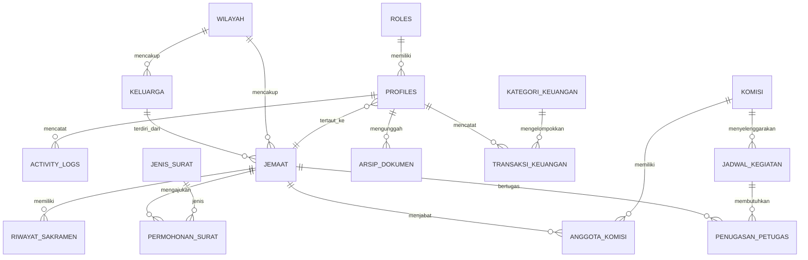

# Desain Basis Data – SIM GKJ Mijen

Dokumen ini mendokumentasikan skema relasional database PostgreSQL yang dikelola melalui **Supabase**.

---

## 1. Diagram Relasi Entitas (ERD)

---

## 2. Struktur Tabel & Relasi Inti

### A. Modul Pengguna & Autentikasi
- **`roles`**: Master peran pengguna (`super_admin`, `pendeta`, `majelis`, `tata_usaha`, `bendahara`, `warga`).
- **`profiles`**: Ekstensi data user Supabase Auth (`auth.users`), menghubungkan akun login dengan record `jemaat`.
- **`activity_logs`**: Pencatatan audit trail (user, aksi, modul, deskripsi, alamat IP, timestamp).

### B. Modul Jemaat & Wilayah
- **`wilayah`**: Pembagian zona pelayanan pastoral gereja.
- **`keluarga`**: Kartu Keluarga gerejawi dengan relasi `wilayah_id`.
- **`jemaat`**: Data lengkap jemaat dengan relasi `keluarga_id` dan `wilayah_id`.
- **`riwayat_sakramen`**: Riwayat penerimaan sakramen/sidi jemaat (`jemaat_id`, `jenis_sakramen`, `nomor_piagam`).

### C. Modul Layanan Surat & Dokumen
- **`jenis_surat`**: Master kategori surat dan format template teks/isian.
- **`permohonan_surat`**: Tracking pengajuan surat jemaat (`pending`, `diproses`, `selesai`, `ditolak`).
- **`arsip_dokumen`**: Repositori berkas PDF/surat keluar-masuk.

### D. Modul Keuangan
- **`kategori_keuangan`**: Pos mata anggaran (pemasukan/pengeluaran).
- **`transaksi_keuangan`**: Buku kas transaksi harian, nomor referensi, nominal, dan link bukti transfer.
- **`penghitungan_persembahan`**: Rekapitulasi fisik kantong merah, hitam, dan persembahan khusus ibadah.

### E. Modul Jadwal & Komisi
- **`komisi`**: Komisi-komisi kategorial gereja.
- **`anggota_komisi`**: Susunan pengurus komisi dan masa jabatan.
- **`jadwal_kegiatan`**: Kalender ibadah, latihan, dan rapat.
- **`penugasan_petugas`**: Penugasan pelayan kebaktian (liturgos, pengkhotbah, pemusik).

### F. Modul Warta & Publikasi
- **`warta_jemaat`**: Buletin warta mingguan terbitan gereja beserta link berkas PDF.
- **`pengumuman`**: Informasi pengumuman jemaat aktif/kadaluarsa.

---

## 3. Strategi Storage Bucket Supabase

| Bucket ID | Hak Akses RLS | Penggunaan |
|---|---|---|
| `documents` | Private (Akses via Signed URL / Majelis & TU) | Berkas arsip surat dan bukti transaksi keuangan. |
| `warta` | Public Read | File PDF buletin warta mingguan jemaat. |
| `avatars` | Public Read | Foto profil akun pengguna dan jemaat. |
